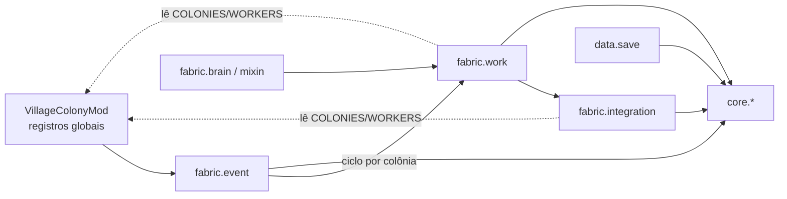

# Auditoria Inicial — Village Colony

> Data: 2026-10-28 · Branch `fix/playtest-0102` em `78346ed8` (código de produção em `dc123149`) · Minecraft 1.21.1, Yarn `1.21.1+build.3`,
> Loader 0.19.3, Fabric API 0.116.15 (`gradle.properties`).
>
> **Etiquetas:** `[FATO]` visto no código, no bytecode, no log ou na fonte Yarn; `[INFERÊNCIA]` conclusão tirada
> da evidência; `[HIPÓTESE]` falta validar; `[NÃO VERIFICADO]` declarado sem prova. As contagens vêm de scripts
> rodados nesta sessão sobre `src/main/java` e `build/classes` (não do README nem do TODO).
>
> **Limites desta auditoria:** o grafo do `graphify-out/` é de 2026-09-28 e está desatualizado — não foi
> reconstruído, porque isso gravaria arquivos fora do entregável. A estrutura foi medida por script de
> varredura do código e por `jdeps` do bytecode. PIT e cobertura da bateria de GameTests **não rodaram**
> nesta sessão.

---

## 1. Mapa Estrutural

**Tamanho** `[FATO]`: 556 classes e 97 mil linhas em `src/main/java`. 88% delas ficam em dois pacotes:
`fabric.work` (209 classes, 43,8 mil linhas) e `fabric.integration` (126 classes, 25,1 mil linhas).

Camadas `[FATO]` (contagem por pacote do script de varredura; a responsabilidade vem do javadoc de cada classe):

| Camada | Pacotes | Responsabilidade |
|---|---|---|
| Domínio puro | `core.*` (14 pacotes, ~16 mil linhas) | Regras sem Minecraft: colônia, obra (`Blueprint`, `ConstructionProject`, `ConstructionPriority`), mina (`Mine`, `MineShaft`), tarefas, ofícios, metas (`ColonyGoals`), ciclo de decisão (`ColonyCycle`) |
| Persistência | `data.save` (11 classes) | `PersistentState` e leitura/escrita em NBT |
| Eventos | `fabric.event` (17) | Detecção e adoção de vila (`VillageDetectionHandler`), ciclo por colônia (`ColonyCycleRunner`), ciclo de vida do servidor e save (`ServerLifecycleHandler`) |
| Integração com o mundo | `fabric.integration` (126) | Ler e editar o mundo: lote (`BuildSiteScanner`, `LotLevel`), ruas (`RoadIndex`, `RoadExtension`, `RoadPaving`, `RoadNetwork`, `StreetSurface`), baús e terreno |
| Trabalho | `fabric.work` (209) | Um `*Work` por ofício (`BuilderWork`, `MinerWork`, `FarmerWork`…), planejamento (`ConstructionPlanner`, `SiteOpening`, `WaitingWork`) e telemetria (`WorkTime`, `ActionJournal`, `VillageDiary`) |
| IA e Mixins | `fabric.brain` (7), `fabric.mixin` (6), `client.mixin` (1) | A tarefa no `Brain` do aldeão e os Mixins (ver §2) |
| Conteúdo e cliente | `fabric.content`, `fabric.overlay`, `client.*` | Blocos de bancada e tocha, overlay de nomes e menu |

**Subsistemas pedidos** `[FATO]`:

| Subsistema | Onde mora |
|---|---|
| ColonyCycle | Decisão pura em `core/coordination/ColonyCycle.java` (417 linhas); a execução está em `fabric/event/ColonyCycleRunner.java` (`runCycleOf`, linha 182) |
| RoadNetwork | `fabric/integration/RoadNetwork.java` (148 linhas), sobre `RoadIndex`, `RoadExtension` e `RoadPaving` |
| ConstructionPriority | `core/construction/model/ConstructionPriority.java` (112 linhas); a vez de cada obra fica em `fabric/work/ConstructionTurn.java` |
| BigHouseMOD | **Não é classe.** É o id de uma planta, referida em `Blueprint`, `ColonyIdentity`, `ProfessionAssigner`, `VillageAdoption` e `ConstructionCancellation`; a fundação dela está em `fabric/integration/BigHouseFoundation.java` |
| Ofícios | `core/worker/service/ProfessionAssigner.java` (488 linhas) e `ProfessionRegistry.java`, `core/coordination/WorkAssignment.java`, mais um `*Work` por profissão em `fabric.work` |

**Ciclos, acoplamento e órfãos:**

- **Ciclos de pacote** `[FATO, jdeps]`: não há `core → fabric` nem `core → net.minecraft`.
  - O único ciclo passa pelo pacote raiz: `VillageColonyMod` registra os pacotes `fabric.*`, e todos eles leem os registros estáticos dele.
  - A regra congelada `theFabricLayerGrowsNoNewPackageCycle` tem hoje o registro **vazio**: os quatro ciclos de 2026-09-30 foram desfeitos.
  - O ArchUnit rodou com 5 regras e 0 falhas (`build/test-results/test/TEST-...ArchitectureRulesTest.xml`).
- **Acoplamento** `[FATO]`: 113 classes referenciam mais de 10 classes do mod. As maiores são `ColonyCycleRunner` (74), `VillageDetectionHandler` (64), `VillagerRegistration` (56), `MinerHands` e `CraftingWork` (41) e `VillageColonyMod` (40).
- **Mais referenciadas** `[FATO]`: `ColonyPos` (189), `ServerMemory` (152), `MinecraftTypeAdapter` (149), `Colony` (137).
- **Órfãos** `[FATO]`: sem referência em `main` e só usados por testes ficam `ColonyFocus`, `EnduranceReport`, `MinerProbe` e `PlanAffordability`. Candidatos a código morto `[INFERÊNCIA]`.
- **Nome repetido** `[FATO]`: `ColonyState` existe em `core.colony.model` (enum) e em `fabric.work` (retrato do `VC_STATE`).

## 2. Contratos Vanilla e Mixins

Os alvos e as assinaturas foram conferidos na fonte Yarn 1.21.1 (`minecraft-merged-…-sources.jar`) `[FATO]`. Os dois arquivos de Mixin usam `"defaultRequire": 1`: um alvo que sumir derruba o carregamento logo, em vez de falhar em silêncio.

| Mixin | Alvo (Yarn 1.21.1) | Injeção | Propósito | Risco de ordem e compatibilidade |
|---|---|---|---|---|
| `VillagerEntityMixin:31` | `VillagerEntity.initBrain(Brain)` (privado, `VillagerEntity.java:220`) | `@Inject` em TAIL | Põe a tarefa da colônia no CORE do cérebro | Baixo: `initBrain` roda de novo ao crescer, ao carregar do NBT e ao refazer o cérebro (`:209`, `:213`, `:256`, `:558`), mas `Brain.copy()` (`Brain.java:392`) cria o cérebro novo **sem tarefas**, então não duplica `[FATO]` |
| `VillagerDataMixin:25` | `VillagerEntity.setVillagerData` (`:597`) | `@ModifyVariable` no argumento, HEAD | Bloqueia a profissão de troca Vanilla nos trabalhadores | Médio `[HIPÓTESE]`: outro mod que também altere `setVillagerData` depende da ordem de aplicação. Não testado com outros mods |
| `HostileSpawnMixin:28` | `HostileEntity.canSpawnInDark` (estático, `:102`) | `@Inject` em HEAD, cancelável | Tocha da colônia impede monstro | Baixo: só devolve `false` |
| `ItemStackCraftMixin:25` | `ItemStack.onCraftByPlayer` (`:883`) | `@Inject` em HEAD | Encanta o item feito na vila (passiva da bancada) | Baixo |
| `LandPathNodeMakerMixin:26` | `LandPathNodeMaker.getNodeType(PathContext,int,int,int,MobEntity)` (`:365`) | `@Inject` em RETURN, cancelável | Chão de curral caro para quem não é pastor | Caminho quente: roda **a cada nó** de qualquer criatura. Hoje sai cedo (`PenFloors.java:62-66`) `[FATO]` |
| `WorkerNameplateMixin:24` (cliente) | `LivingEntityRenderer.hasLabel` (`:244`) | `@ModifyReturnValue` | Esconde o nome Vanilla quando o overlay desenha | Baixo; só cliente |

**Classes que estendem ou implementam tipos do jogo** `[FATO]`:

- `PersistentState`: `ColonySavedData`, `ProfessionPolicySavedData`, `WorkMarksSavedData`, `WorkMemorySavedData`.
- `MultiTickTask`: `GoToWorkTargetTask`.
- Blocos e telas de bancada:
  - `BenchForgeBlock` e `BenchForgeBlockEntity` (forno abstrato);
  - `BenchComposterBlock`;
  - `BenchCraftingBlock`, `BenchLoomBlock` e `BenchStonecutterBlock`, cada um junto com a tela Vanilla dele.
- `TorchBlock` e `WallTorchBlock`: as tochas da colônia.
- Telas de cliente: `Screen` ×2.

A regra `aMixinOnlyDelegates` do ArchUnit garante que o Mixin só delega a outra classe.

## 3. Estado de Persistência Atual

**Fluxo** `[FATO]`:

- Os registros em memória (`VillageColonyMod.COLONIES`, `WORKERS`, `CONSTRUCTIONS`, `BUILDINGS` e `MINES`, mais as ruas, as varreduras e os traços de atividade) são copiados para o `ColonySavedData` por `copyToSavedData` (`ServerLifecycleHandler.java:279`).
- A cópia acontece em `BEFORE_SAVE` (`:50`), isto é, no autosave e ao fechar o servidor.
- Ela marca o estado para gravar uma vez por cópia (`ColonySavedData.java:329`, `markDirty`).
- Na mesma passada, as marcas de trabalho vão para o `WorkMarksSavedData`: recusas da mina, rastros, baús dos trabalhadores e plantas tiradas pelo jogador.

**Robustez e esquema** `[FATO]`:

- **Leitura defensiva:** cada entrada e cada seção são lidas dentro de um `try` que descarta com aviso (`ColonySaveReader.java:150-163`). Isso evita o "estado vazio gravado por cima" do `PersistentStateManager`.
- **Enums lidos do disco:** o `ProfessionPolicySavedData` usa `valueOf` cru, mas com `catch (IllegalArgumentException)` (`:83-86`, `:111-112`).
- **Versão do esquema:** `SaveMigration.CURRENT = 1` (`:47`). A única migração é v0 → v1 (`BREEDER` → `SHEPHERD`).
- **A mina tem versão própria:** `MineSave.SHAPE_VERSION = 8` (`:114`).

**Riscos de persistência:**

1. **Perda entre autosaves** `[INFERÊNCIA]`: um fechamento brusco perde o que mudou desde o último `BEFORE_SAVE`. É o comportamento normal do jogo e é aceitável.
2. **Estado só em memória** `[FATO]`: cerca de 150 classes são transitórias de propósito, ligadas ao `ServerMemory` (152 referências) e apagadas a cada reinício. Entre elas estão regras novas de 2026-10-28:
   - `StripLot.MISSES` (`StripLot.java:64`): o alcance da faixa volta a 48 depois de reiniciar.
   - `VillageDiary.DAY` (`:51`): o resumo do dia (`VC_DAY`) perde o que acumulou se o servidor fechar no meio do dia; o primeiro resumo depois de reiniciar só sai na segunda virada de dia `[INFERÊNCIA]`.
   - `NightHome.STILL`.

   Nenhum desses causa corrupção; eles mudam comportamento depois de um reinício.
3. **Migração pendente** `[INFERÊNCIA]`: diminuir o salão da mina (`MineShaft.HALL_SIDE`, próximo passo do roteiro) muda a geometria das minas que já estão abertas. Exige subir o `SHAPE_VERSION` e testar a leitura de um save com a mina antiga; hoje há 6 arquivos de teste que citam `MineSave` ou `SHAPE_VERSION`.
4. **Centro fixo sem teste de ida e volta** `[NÃO VERIFICADO]`: a caixa e o centro já eram gravados (`VillageBoundsSave`), mas nenhum teste grava e lê de volta o centro fixo (Regra 141).

## 4. Riscos Críticos (5 priorizados)

### R1 — Picos de tique no ciclo da colônia (impacto: lag de tique)

- **Evidência** `[FATO]`: `cost_ledger.py` sobre o log da simulação de 10 dias (`run/biome-sim/reports/taiga/latest.log`, 1 colônia):
  - total por ciclo: média 25 ms, p95 40 ms, máximo 145 ms;
  - planejador: p95 34 ms, máximo 113 ms;
  - 26 avisos de ciclo mais longo que um tique, o pior de 730 ms (planejador 520 ms) e outro de 505 ms (detecção 499 ms).
- **Orçamento** `[FATO]`: `PlanningBudget.DEADLINE_MS = 15` (`PlanningBudget.java:30`).
- **Hipóteses:**
  - **H1** — a abertura do lote roda fora do prazo: `SiteOpening.java:238` (`LotTerraform.level`) e `:286` (`SiteSurroundings.level`) não checam o prazo `[FATO]`. *Parcialmente confirmada:* o pico de 730 ms coincide com a primeira obra (nivelar 59 blocos e limpar 42), mas os de 168 e 144 ms não têm abertura por perto.
  - **H2** — aquecimento da JVM no primeiro ciclo: *compatível*, porque os dois maiores picos são o primeiro ciclo com obra e o ciclo em que a colônia nasce.
  - **H3** — a janela de 64 colunas do mapa de interesse (`RoadIndex`): *não medida*.
  - A simulação usa `/tick sprint`, e os números absolutos podem estar inflados.
- **Mitigação:** medir com o Spark durante a abertura de uma obra antes de mexer (ADR-035 §5) e, se H1 se confirmar, fatiar o nivelamento com o prazo do planejador.

### R2 — Leitura de bloco em chunk não carregado (impacto: lag e geração de chunk na thread do servidor)

- **Evidência** `[FATO]`: `World.getBlockState` (`World.java:408`) chama `getChunk(x, z, FULL)` (`:227`), que carrega o chunk na hora.
- **Escala** `[FATO]`: são 323 chamadas a `getBlockState` contra 113 guardas de "chunk carregado". É contagem bruta: muitas leituras estão em áreas já garantidas.
- **Caso concreto** `[FATO]`: `VillageHelpers.lightNear` (`VillageHelpers.java:226-229`) lê 13×5×13 blocos em volta da rua, e a guarda da linha 197 confere só o chunk da coluna central.
- **Hipótese:** outras varreduras de raio fixo têm a mesma lacuna `[HIPÓTESE, não verificado classe a classe]`.
- **Mitigação:** guarda por chunk dentro dos laços 3D, e um GameTest com a borda da área num chunk descarregado.

### R3 — Estado estático que sobrevive à troca de mundo (impacto: decisão errada no mundo seguinte)

- **Evidência** `[FATO]`: a regra congelada `aStaticMutableCollectionIsServerMemory` guarda 10 violações (`src/test/resources/archunit_store/9f6005cc-…`), entre elas `ConstructionOrder` (3 coleções), `ColonyCycleRunner`, `CycleCost`, `SiteSignJanitor`, `ToolUpgrade` e `SweepState` (8 coleções).
- **Limpeza parcial** `[FATO]`: o `SweepState` é limpo pelo `BuildSiteScanner.clearAll` (`:429-436`), mas o `LOT_SCORE` (`SweepState.java:115`, criado em 2026-10-28) ficou de fora.
- **Hipótese:** as chaves são o UUID da colônia, então o estado velho seria só lixo e não colisão `[HIPÓTESE]`. Não foi verificado, coleção a coleção, se alguma usa chave que não seja UUID.
- **Mitigação:** registrar as classes no `ServerMemory` e encolher o registro congelado.

### R4 — Regras novas sem teste automatizado (impacto: regressão silenciosa e travamento de IA)

- **Evidência** `[FATO]`: nenhum teste cita
  - `VillageHelpers` (pedreiro e fundidor ajudantes);
  - o alcance da faixa anexada (`StripLot.REACH`, `reachOf`);
  - a busca de casa a 128 blocos (`NightHome.hasPathHome`, `HOME_RANGE`).
- Do `VillageDiary` só a auditoria é testada; os eventos e o resumo do dia, não.
- **Causa:** o código foi escrito antes do teste, o que fere as regras 2 e 3 do `CLAUDE.md` §2.
- **Mitigação:** §6.

### R5 — Concentração em poucas classes e teto de tamanho no limite (impacto: manutenção e defeito por acoplamento)

- **Evidência** `[FATO]`:
  - 8 arquivos estão entre 498 e 501 linhas, contra o teto do `FileSizeRuleTest`: `ColonyGoals`, `SurfaceGatheringWork`, `LumberjackWork`, `ColonyCycleRunner`, `ConstructionProject`, `SmelterWork`, `FarmerWork` e `CropPatch`.
  - 113 classes passam de 10 dependências.
  - A cobertura unitária de `fabric/work` é de 14% e a de `fabric/integration` de 10%; a do `core` fica entre 86% e 100% (JaCoCo desta sessão, só testes unitários).
- **Hipótese:** o teto empurra lógica nova para classes vizinhas, e o acoplamento cresce `[HIPÓTESE]`. Em 2026-10-28 isso aconteceu três vezes: em `BuilderWork`, `ColonyCycleRunner` e `SurfaceGatheringWork`.
- **Mitigação:** dividir por um eixo natural (fase da obra, profissão) com teste que prove a equivalência. Não é P0.

## 5. Ofensores de Complexidade (top 3)

A ciclomática é aproximada por script; a cognitiva vem do PMD (`build/reports/pmd/main.xml`, que só mede complexidade cognitiva: 100 violações).

| # | Método | Medida | Por quê |
|---|---|---|---|
| 1 | `ColonyCycleRunner.runCycleOf` (`fabric/event/ColonyCycleRunner.java:182`) | 250 linhas, classe com 74 dependências e 499 linhas | É o orquestrador do ciclo: tudo passa por ele e todo ofício é chamado dele |
| 2 | `LotLevel.flatGroundAt` (`fabric/integration/LotLevel.java:112`) | ~284 linhas, ciclomática ~29, cognitiva 49 | Decide se um lote é plano e cabe na casa; regra de falha silenciosa (lote recusado sem motivo visível) |
| 3 | `Corridor.plan` (`fabric/integration/Corridor.java:146`) | Cognitiva 51, a maior do PMD | Traça o caminho da porta à rua; já teve crash na 0.3.89 por chave de mapa inconsistente `[NÃO VERIFICADO no código: registro de sessões anteriores]` |

Logo atrás: `MineCuts.nextCut` (cognitiva 46, `:42`), `BuildSiteScanner.findForFootprints` (42, `:192`) e `BuilderPlacement.placeOne` (ciclomática ~29, 211 linhas, `:65`).

## 6. Lacunas de Teste e Plano Mínimo (3–5 testes)

**Existentes** `[FATO]`:

- JUnit: 227 classes e 1.616 testes, todos verdes em `./gradlew test` nesta sessão.
- GameTest: 233 classes com `@GameTest`, todas registradas no `src/gametest/resources/fabric.mod.json` (nenhuma fora da bateria). A última bateria rodou 909 casos com 0 falhas.
- Scripts Python: 15 arquivos de teste.
- **Coberto:** núcleo puro (ciclo, metas, obra, mina, tarefas), persistência (`ColonySavedDataTest`, `SaveMigration` em 2 arquivos, `MineSave` em 6) e a maior parte das regras de obra e de profissão por GameTest.
- **Descoberto (falha silenciosa):** os itens do R4, a limpeza do `LOT_SCORE` (R3), a guarda de chunk nas varreduras (R2) e o save de ida e volta do centro fixo (§3.4).

**Plano mínimo**, cada um em vermelho → verde → refatorar:

| # | Teste | Tipo | Cobre | Muda o quê para ficar vermelho | Prioridade |
|---|---|---|---|---|---|
| T1 | `theWorldUnloadForgetsTheLotScore` | JUnit (`BuildSiteScanner.clearAll` + `SweepState.lastLotScore`) | R3 | **Já falha hoje**: `LOT_SCORE` não é limpo | Alta: é um defeito real, e o teste prova a correção de uma linha |
| T2 | `aStreetLightNeverLoadsAChunk` | GameTest | R2, `VillageHelpers.lightNear` | Coluna de rua escura com o vizinho a 6 blocos num chunk descarregado; afirma que nenhum chunk novo carregou. **Deve falhar hoje** `[HIPÓTESE]` | Alta: é lag em jogo |
| T3 | `theColonyCenterSurvivesSaveAndLoadAfterTheBoxGrew` | JUnit (ida e volta pelo `ColonySavedData`) | §3.4, Regra 141 | Colônia medida e depois crescida; grava e lê; afirma o mesmo centro. Fica vermelho se o leitor recalcular o centro pelo meio da caixa | Média: persistência de uma regra estrutural |
| T4 | `aVillagerFarFromItsBedWalksHomeInsteadOfTeleporting` | GameTest | R4, `NightHome.hasPathHome` | Cama a ~60 blocos com caminho livre; afirma que não houve teleporte. Fica vermelho se a busca voltar a 48 blocos | Média: regra 142 sem prova |
| T5 | `theMasonMendsTheGapNearestToItFirst` / `theSmelterHaulsTheMineMouthToThePublicChests` | GameTest | R4, `VillageHelpers` | Baú da boca com minério; afirma que o minério chega ao baú público. Fica vermelho se `HAUL` for 0 | Baixa: os ajudantes não travam nada se falharem |

## 7. Próximo Passo Recomendado (no momento da auditoria; feito — ver "Andamento")

Escrever o T1 e o T2 (o defeito confirmado do `LOT_SCORE` e a guarda de chunk do `lightNear`), vê-los falhar, corrigir e só então retomar a mina, já com a migração do `SHAPE_VERSION` planejada.

---

## Andamento depois da auditoria (2026-10-28)

O texto acima é o retrato do momento da auditoria. O que mudou desde então, cada item com teste que falhou
antes da correção, ou com a mutação que o teste pega:

| Item | Estado | Commit | O que o teste mostrou |
|---|---|---|---|
| T1 — nota do lote entre mundos (R3) | ✅ corrigido | `16dfe634` | `OptionalDouble[42.0]` sobrevivia ao `ServerMemory.resetAll` |
| T2 — busca de luz carregando chunk (R2) | ✅ corrigido | `95aaaa72` | O vizinho `[30241, 30000]` era carregado |
| R2 — lugar da lanterna na borda do chunk | ✅ corrigido | `ce977bee` | Ler o lugar **e** avisar os vizinhos ao pôr a lanterna carregavam o vizinho |
| T3 — centro fixo depois do save (§3.4) | ✅ corrigido | `3003e1a1` | **Defeito real:** `VillageBoundsSave.read` usava `measure`, e o centro ia de z=50 para z=150 a cada carga |
| Mina — salão 17 → 9 e forma 9 | ✅ feito | `d20c0d10` | ~1.755 blocos por nível em vez de ~4.875; salão 7 testado e rejeitado (quebra o traçado). Corrigiu também um **defeito latente**: a 0.3.96 mudou o salão sem subir a forma 8, e o cursor salvo de uma mina antiga apontava para outra posição |
| T4 — caminho de casa a 128 blocos (R4) | ✅ teste | `611b0529` | Mutação `HOME_RANGE` 128 → 48 teleportou o aldeão a 60 blocos |
| T5 — fundidor leva minério (R4) | ✅ teste | `611b0529` | Mutação `HAUL` 64 → 0 deixou o minério na boca |
| Versão 0.3.103 | ✅ | `c5b44697` | `build --rerun-tasks` verde; test 1620, Python 136, GameTest 913; JAR instalado (SHA-256 `da400ff7…2782`) |

**Ainda abertos:**

- **R1:** medir o pico do planejador com o Spark na abertura de uma obra.
- **R2:** varredura das demais leituras 3D fora do `VillageHelpers` (não feita classe a classe).
- **R3:** as outras 9 classes com estado estático fora do `ServerMemory`.
- **R5:** divisão das classes no teto de 500 linhas.

---

Gate de verificação (Fase 5): toda afirmação acima cita arquivo e linha, saída de comando ou fonte Yarn, ou está marcada `[HIPÓTESE]`, `[INFERÊNCIA]` ou `[NÃO VERIFICADO]`. Nenhum arquivo do projeto além deste foi alterado nesta auditoria. A saída de build gerada por `pmdMain` e `jacocoTestReport` fica em `build/`, que é ignorado pelo git.
